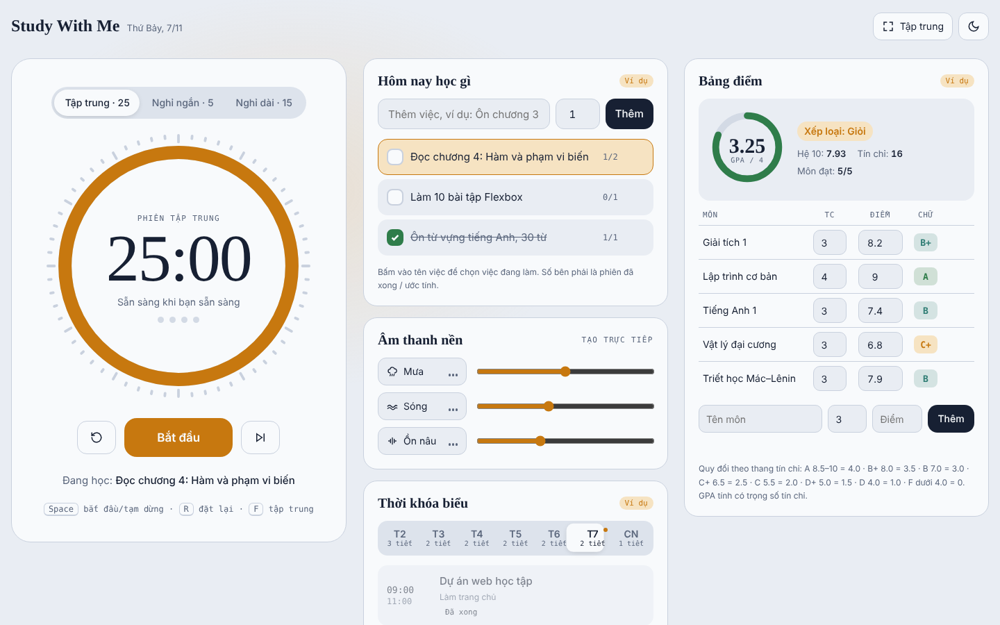
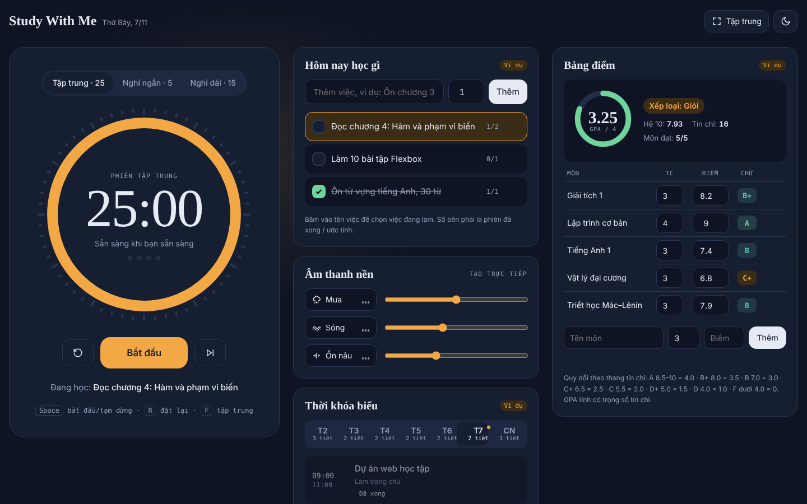
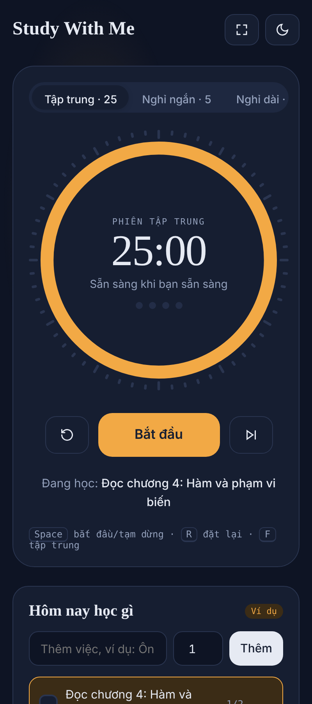

# Study With Me

Bàn học trên trình duyệt: đồng hồ Pomodoro, âm thanh nền, danh sách việc cần làm, thời khóa biểu và bảng điểm tính GPA, tất cả trong một trang. Viết bằng **HTML, CSS và JavaScript thuần**, không framework, không cần cài đặt hay build.
https://hanny2005.github.io/study-with-me/
<h2 align="center">📸 Giao diện website</h2>

<p align="center">
  
  

<p align="center">
  
</p>

<p align="center">
  
</p>
<h2 align="center">📸 Giao diện Mobile</h2>
<p align="center">
  
  &nbsp;&nbsp;
  
  &nbsp;&nbsp;
  
</p>

## Tính năng

|Phần|Làm được gì|
|-|-|
|**Đồng hồ Pomodoro**|Tập trung 25 phút, nghỉ ngắn 5 phút, nghỉ dài 15 phút. Vòng tròn đếm lùi, chuông báo khi hết giờ, tự chuyển chế độ, cứ 4 phiên tập trung thì nghỉ dài. Tiêu đề tab hiện thời gian còn lại.|
|**Hôm nay học gì**|Thêm việc kèm số phiên ước tính, chọn việc đang làm, đánh dấu xong. Mỗi phiên tập trung hoàn thành được cộng vào việc đang chọn.|
|**Âm thanh nền**|Mưa, sóng biển, tiếng ồn nâu, tạo trực tiếp bằng Web Audio API (không cần file âm thanh). Mỗi loại có âm lượng riêng.|
|**Thời khóa biểu**|Xem theo từng thứ (T2 → CN). Ở ngày hôm nay, tiết đang học được tô sáng kèm thanh tiến độ, tiết kế tiếp ghi "Sau X phút". Thêm, xóa tiết, cảnh báo khi trùng giờ.|
|**Bảng điểm \& GPA**|Nhập điểm thang 10 và số tín chỉ, sửa trực tiếp trong bảng. Tự quy đổi điểm chữ, tính GPA hệ 4 và hệ 10 có trọng số tín chỉ, xếp loại học lực.|
|**Chế độ Tập trung**|Ẩn mọi thứ, chỉ để lại đồng hồ.|
|**Sáng / tối**|Theo cài đặt máy, hoặc đổi bằng nút trên đầu trang (hiệu ứng vòng tròn lan ra).|

## Chạy thử

Không cần cài gì. Tải về rồi mở `index.html` bằng trình duyệt:

```bash
git clone https://github.com/<tên-bạn>/study-with-me.git
cd study-with-me
# mở index.html, hoặc chạy một server tĩnh bất kỳ:
python -m http.server 8000  

&#x20;# rồi vào http://localhost:8000
```

Muốn đưa lên mạng: bật **GitHub Pages** trong *Settings → Pages*, chọn nhánh `main` và thư mục gốc `/`.

## Phím tắt

|Phím|Tác dụng|
|-|-|
|`Space`|Bắt đầu / tạm dừng|
|`R`|Đặt lại phiên hiện tại|
|`F`|Bật / tắt chế độ Tập trung|
|`←` `→`|Chuyển chế độ đồng hồ hoặc chuyển thứ trong thời khóa biểu (khi đang chọn nút)|

## Cấu trúc thư mục

```
study-with-me/
├── index.html            khung trang
├── css/
│   ├── motion.css        token chuyển động (spring, curve, thời lượng) — từ skill html-motion
│   └── style.css         giao diện: màu, chữ, bố cục, các thành phần
├── js/
│   ├── motion.js         hàm chuyển động dùng chung (window.Motion) — từ skill html-motion
│   └── app.js            logic: đồng hồ, việc cần làm, âm thanh, thời khóa biểu, bảng điểm
├── docs/                 ảnh chụp màn hình cho README
└── skills/
    └── html-motion/      skill dùng để tạo hệ chuyển động của trang (xem bên dưới)
```

## Dữ liệu được lưu ở đâu

Mọi thứ lưu trong `localStorage` của trình duyệt, với tiền tố `swm-`:

|Khóa|Nội dung|
|-|-|
|`swm-tasks`, `swm-current`|Danh sách việc và việc đang chọn|
|`swm-tt`|Thời khóa biểu|
|`swm-grades`|Bảng điểm|
|`swm-log`, `swm-cycle`|Số phút / số phiên tập trung theo ngày, vị trí trong chu kỳ 4 phiên|
|`swm-theme`|Giao diện sáng / tối đã chọn|

Không có máy chủ, không gửi dữ liệu đi đâu. Dữ liệu chỉ có trên trình duyệt và máy đang dùng; xóa dữ liệu trang web là mất. Lần đầu mở trang, việc cần làm, thời khóa biểu và bảng điểm hiện **dữ liệu mẫu** (có nhãn "Ví dụ"); sửa, thêm hoặc xóa là chúng thành dữ liệu của bạn.

## Cách tính GPA

Điểm thang 10 được quy đổi theo thang tín chỉ phổ biến ở các trường đại học Việt Nam:

|Thang 10|Điểm chữ|Thang 4|
|-|:-:|:-:|
|8.5 – 10|A|4.0|
|8.0 – 8.4|B+|3.5|
|7.0 – 7.9|B|3.0|
|6.5 – 6.9|C+|2.5|
|5.5 – 6.4|C|2.0|
|5.0 – 5.4|D+|1.5|
|4.0 – 4.9|D|1.0|
|dưới 4.0|F|0|

```
GPA = Σ (điểm hệ 4 của môn × số tín chỉ) / Σ số tín chỉ
```

Xếp loại theo GPA hệ 4: **Xuất sắc** ≥ 3.6 · **Giỏi** ≥ 3.2 · **Khá** ≥ 2.5 · **Trung bình** ≥ 2.0 · **Yếu** < 2.0.

Trường bạn dùng mốc khác? Sửa mảng `SCALE` và hàm `rankOf` trong `js/app.js`.

## Tùy chỉnh

|Muốn đổi|Sửa ở đâu|
|-|-|
|Thời lượng Pomodoro|Đối tượng `MODES` trong `js/app.js` (nhớ sửa cả chữ trên nút trong `index.html`)|
|Tốc độ mọi chuyển động|`--tempo` trong `css/motion.css`: `0.85` nhanh hơn, `1.15` chậm hơn|
|Độ nảy, độ mờ khi xuất hiện|Các token `--spring-\\\*`, `--blur-\\\*`, `--shift-\\\*` trong `css/motion.css`|
|Màu sắc|Khối `:root` (sáng) và hai khối giao diện tối ở đầu `css/style.css`|
|Phông chữ|Thẻ Google Fonts trong `index.html` và các biến `--font-\\\*` trong `css/style.css`|
|Dữ liệu mẫu|Mảng mẫu trong các phần *Tasks*, *Thời khóa biểu*, *Bảng điểm* của `js/app.js`|

## Chuyển động

Hệ chuyển động của trang được viết theo nguyên tắc của [Animate UI](https://animate-ui.com), chuyển sang HTML/CSS/JS thuần qua skill **html-motion** trong thư mục `skills/`:

* Gần như mọi chuyển động chạy trên **spring** (CSS `linear()` sinh từ mô phỏng lò xo), mỗi vai trò có một token riêng.
* Chỉ animate `transform`, `opacity`, `filter`; exit nhanh hơn entrance; popup mọc từ nút mở nó.
* Bấm lại giữa chừng thì chuyển động tiếp tục từ vị trí hiện tại, không giật về đầu.
* Bàn phím chuyển động giống chuột.
* Tôn trọng **Giảm chuyển động** (`prefers-reduced-motion`): mọi thứ vẫn hiện ra và biến mất, chỉ không di chuyển.

## Skill `html-motion`

`skills/html-motion/` là một **Agent Skill** dành cho Claude: khi được cài, Claude dùng nó mỗi lần bạn nhờ làm animation cho web HTML/CSS/JS thuần. Chi tiết trong [skills/html-motion/README.md](skills/html-motion/README.md).

## Trình duyệt hỗ trợ

Chrome / Edge 113+, Safari 17.2+, Firefox 112+ (cần CSS `linear()` cho hiệu ứng spring). Trình duyệt cũ hơn vẫn chạy; chuyển động lùi về ease-out thường. Hiệu ứng đổi giao diện dạng vòng tròn cần View Transitions API (Chrome/Edge 111+, Safari 18+); nơi chưa hỗ trợ thì đổi ngay.

## Trợ năng

* Điều khiển được hoàn toàn bằng bàn phím, có viền focus rõ.
* Tabs, nút bật/tắt, vùng thông báo dùng đúng thuộc tính ARIA (`role="tablist"`, `aria-pressed`, `aria-live`…).
* Thông báo lỗi trong form nói rõ sai gì và cách sửa.

## 

